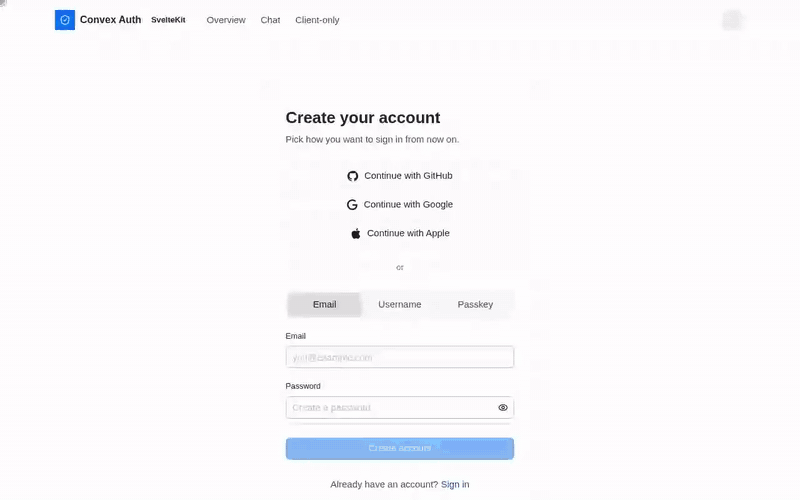

# Convex Auth for Svelte and SvelteKit

Svelte bindings for [Convex Auth v2](https://github.com/get-convex/convex-auth) (`@convex-dev/auth@2`). The API mirrors upstream's React and Next.js clients, so upstream's docs for the backend apply as they are.



## Get started

```bash
pnpm add @mmailaender/convex-auth-svelte@alpha @convex-dev/auth convex convex-svelte
```

Then follow the guide for your app:

| Guide                                    | For                                                                                                                                   |
| ---------------------------------------- | ------------------------------------------------------------------------------------------------------------------------------------- |
| [SvelteKit](src/lib/sveltekit/README.md) | SvelteKit with server-side rendering. The refresh token stays in an httpOnly cookie, and pages render signed in on the first request. |
| [Svelte](src/lib/svelte/README.md)       | Client-only apps. The tokens live in `localStorage`, or in the storage you pass.                                                      |

Version 1.x supports Convex Auth v2 only. Apps on Convex Auth v1 (`@convex-dev/auth@0.0.x`) stay on `@mmailaender/convex-auth-svelte@0.1.x`.

## Sign-in methods

Each method has the helpers of upstream's React client, from `@mmailaender/convex-auth-svelte/methods/<method>`:

| Method                | Helpers                                                                                                                                 |
| --------------------- | --------------------------------------------------------------------------------------------------------------------------------------- |
| Username + password   | `useSignInWithUsernamePassword`, `useSignUpWithUsernamePassword`                                                                        |
| Email + password      | Sign-in, sign-up with a validation link, password reset and email change, e.g. `useSignUpWithEmailPassword`, `useStartPasswordRecovery` |
| Passkeys              | `useSignInWithUsernamePasskey`, with browser autofill, plus `useAddPasskey` and `useRemovePasskey`                                      |
| Google, Apple, GitHub | `useSignInWithGoogle`, `useSignInWithApple`, `useSignInWithGithub`                                                                      |

## Reference app

The demo in `src/routes` has UI for every method above, and the account management that comes with each: profile, avatar, change email and password, and passkeys. Copy the components you need from [src/demo](src/demo/README.md). They aren't part of the package.

## Upgrade from 0.1.x

Convex Auth v2 is a rewrite. The backend moves to components and per-method setup functions, so start with upstream's [migration notes](https://github.com/get-convex/convex-auth/blob/main/packages/docs/docs/migrating/from-convex-auth-v1.mdx). v2 has fewer sign-in methods than v1 at launch (no magic links, OTP, anonymous sign-in or arbitrary Auth.js providers), and upstream's migration tooling for existing user data isn't out yet.

On the Svelte side, the API now mirrors upstream's React and Next.js clients. The migration sections of the [SvelteKit](src/lib/sveltekit/README.md#migrate-from-01x) and [Svelte](src/lib/svelte/README.md#migrate-from-01x) guides show each change as a before/after:

- `useAuth()` from this package is gone: the state comes from `useAuth()` of `convex-svelte`, and the actions from `useAuthActions()`.
- `signIn(provider, params)` is gone: each method has the helpers of upstream's React client, e.g. `useSignInWithUsernamePassword(api.auth)`.
- SvelteKit: `createConvexAuthHooks` and `createConvexAuthHandlers` become `setupConvexAuthSvelteKit`, and sign-in goes through three auth routes from upstream instead of `POST /api/auth`. The refresh token no longer reaches page data.

See [docs/upstreaming.md](docs/upstreaming.md) for how this maps onto `@convex-dev/auth` and what a PR there could share.

## Develop

`pnpm dev` runs the reference app against the Convex deployment in `.env.local`. `/` is the SvelteKit app and `/spa` the client-only one. See [src/demo/README.md](src/demo/README.md) for the environment variables, and [e2e/README.md](e2e/README.md) to run the tests.
